# BÁO CÁO BÀI TẬP THỰC HÀNH LẬP TRÌNH C# WINFORMS

## I. THÔNG TIN SINH VIÊN

* **Họ và tên:** Đặng Cao Thành Đạt
* **Mã số sinh viên:** 24810320215
* **Lớp học phần:** Lập trình .NET – Lớp: D19QTANM1
* **Link Repository:** https://github.com/datdct24810320215-cloud/-LTNET-Bai5.3_5.4_5.5_24810320215_DangCaoThanhDat.git

---

## II. DANH SÁCH BÀI TẬP HOÀN THÀNH & TỰ ĐÁNH GIÁ

| Bài tập | Tiêu đề bài tập | Trạng thái | Mức độ hoàn thành (%) |
| :---: | :--- | :---: | :---: |
| **Bài 5.3** | Hệ thống Quản lý Quán Cafe & Bán hàng (POS Cafe System) — Bài tập 5.3 | Hoàn thành | 100% |
| **Bài 5.4** | Hệ thống Quản lý Tiện ích Dịch vụ & Khách sạn (Hotel Management System) — Bài tập 5.4 | Hoàn thành | 100% |
| **Bài 5.5** | Hệ thống Quản lý Quy trình Xuất - Nhập Kho Nguyên Vật liệu (Inventory Management) — Bài tập 5.5 | Hoàn thành | 100% |

---

## III. MINH HỌA GIAO DIỆN & KỸ THUẬT NỔI BẬT

### 1. Bài 1: Hệ thống Quản lý Quán Cafe & Bán hàng (POS Cafe System)

* **Kỹ thuật áp dụng:**
  - Mô hình ngắt kết nối (Disconnected Model): `DataSet`, `DataTable`, `SqlDataAdapter` để nạp menu và quản lý hóa đơn tạm.
  - Giao diện WinForms quản lý theo Sơ đồ bàn (Visual Table Layout) với Button động (màu xanh = Trống, màu đỏ = Có khách).
  - `SqlTransaction` đảm bảo đồng bộ khi Thanh toán (cập nhật HoaDon + trạng thái BanAn).
  - Kiến trúc 3-Tier CRUD cho Quản lý Thực đơn, validation `ErrorProvider` chặn đơn giá âm / tên món trống.
  - `SqlParameter` chống SQL Injection.

* **Hình ảnh minh họa Giao diện:**

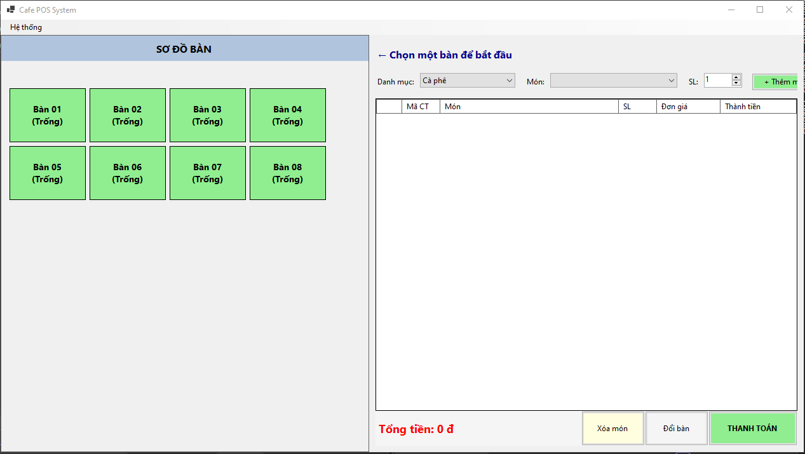

*Mô tả: Sơ đồ bàn dạng Button động — bàn "Trống" màu xanh, bàn "Có khách" màu đỏ.*

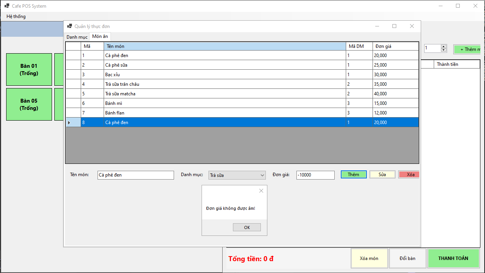

*Mô tả: Form CRUD Thực đơn — Thêm, Sửa, Xóa món, cập nhật giá bán, validation chặn đơn giá âm / tên trống.*

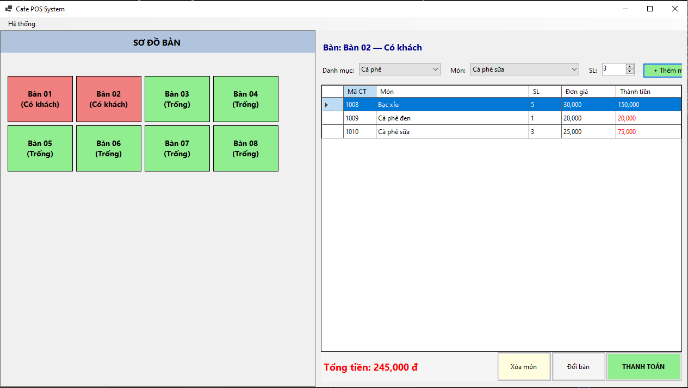

*Mô tả: Chọn bàn "Có khách" → DataGridView hiển thị món đã đặt; thêm món từ danh mục; nút Thanh toán xử lý SqlTransaction.*

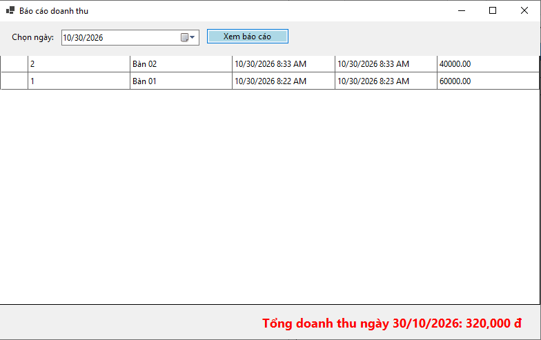

*Mô tả: Báo cáo doanh thu theo ngày / hóa đơn, top món bán chạy.*

### 2. Bài 2: Hệ thống Quản lý Tiện ích Dịch vụ & Khách sạn (Hotel Management System)

* **Kỹ thuật áp dụng:**
  - Kiến trúc 3-Tier phân lớp rõ ràng: `DTO`, `DAL`, `BUS`, `GUI`.
  - Check-in: tra cứu khách hàng theo CCCD bằng `SqlParameter`; thêm khách mới nếu chưa tồn tại.
  - Gọi dịch vụ: luân chuyển dữ liệu qua `ServiceDTO` / `ProductDTO` qua lớp BUS và DAL.
  - Check-out: `SqlTransaction` tính tổng tiền (thời gian ở × giá phòng + dịch vụ), cập nhật `NgayTraPhong`, `TongTienThanhToan`, chuyển phòng sang "Đang dọn dẹp".
  - Lọc & tìm kiếm phòng ngắt kết nối bằng `DataView` / `DataTable`.

* **Hình ảnh minh họa Giao diện:**

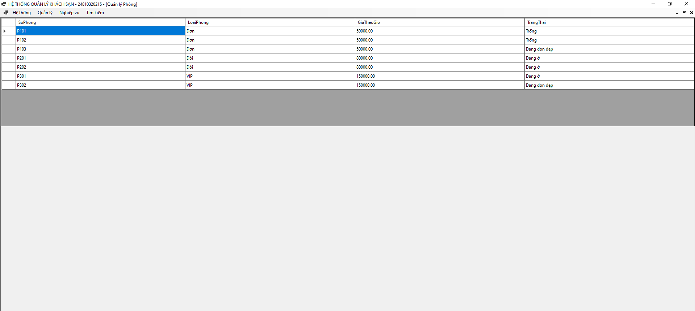

*Mô tả: Danh sách phòng với trạng thái Trống / Đang ở / Đang dọn dẹp.*

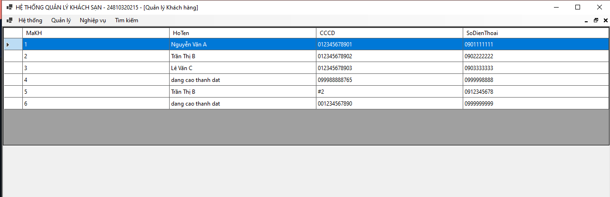

*Mô tả: Form quản lý Phòng, Khách hàng.*

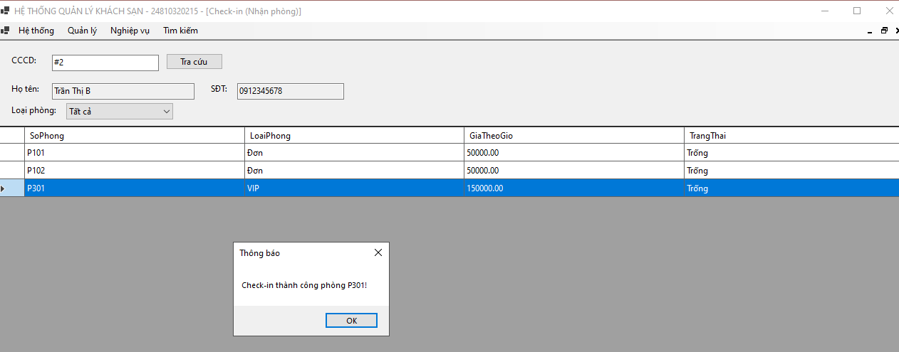

*Mô tả: Form Check-in tra cứu CCCD bằng SqlParameter, chọn phòng trống, lập phiếu nhận phòng.*

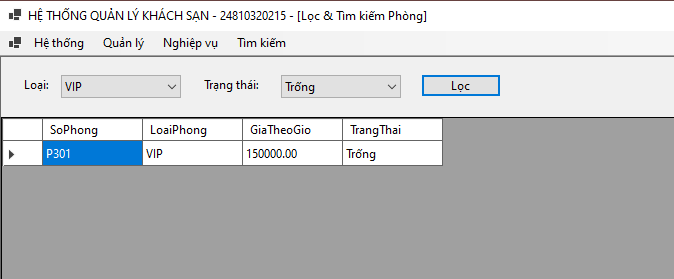

*Mô tả: Lọc phòng theo Loại phòng / Trạng thái bằng DataView.*

---

### 3. Bài 3: Hệ thống Quản lý Quy trình Xuất - Nhập Kho Nguyên Vật liệu (Inventory Management)

* **Kỹ thuật áp dụng:**
  - `SqlTransaction` xử lý biến động tồn kho đa bảng khi Nhập / Xuất kho (nguyên tắc ACID).
  - Phân tầng 3-Tier chuẩn hóa: `DTO`, `DAL`, `BUS`, `GUI`.
  - Chống SQL Injection 100% bằng `SqlParameter`.
  - `ExecuteScalar` tính tổng giá trị hàng hóa tồn kho.
  - Cảnh báo tồn kho dưới ngưỡng an toàn.

* **Hình ảnh minh họa Giao diện:**

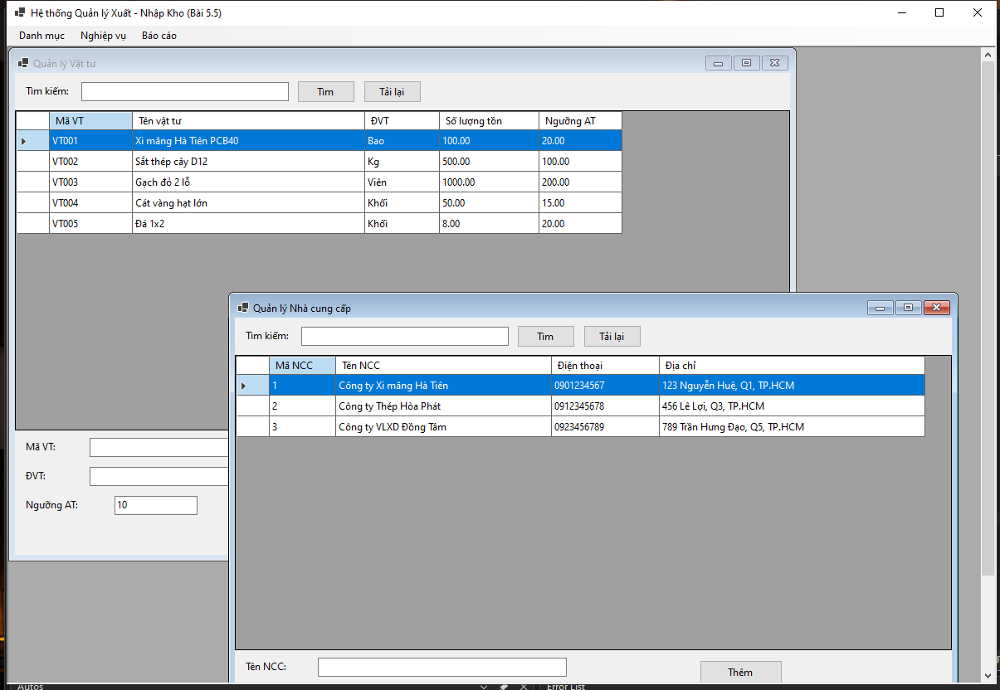

*Mô tả: Dashboard tổng quan kho — tổng vật tư, tổng giá trị tồn kho.*

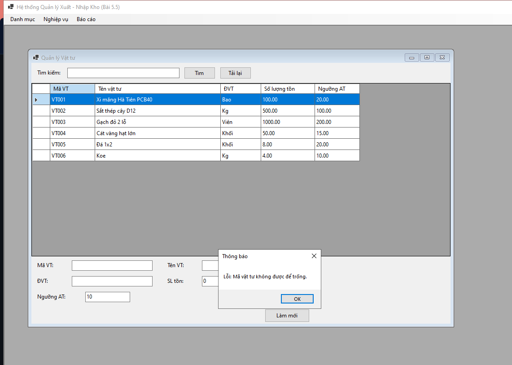

*Mô tả: Form CRUD Vật tư / Nhà cung cấp — Thêm, Sửa, Xóa, tra cứu.*

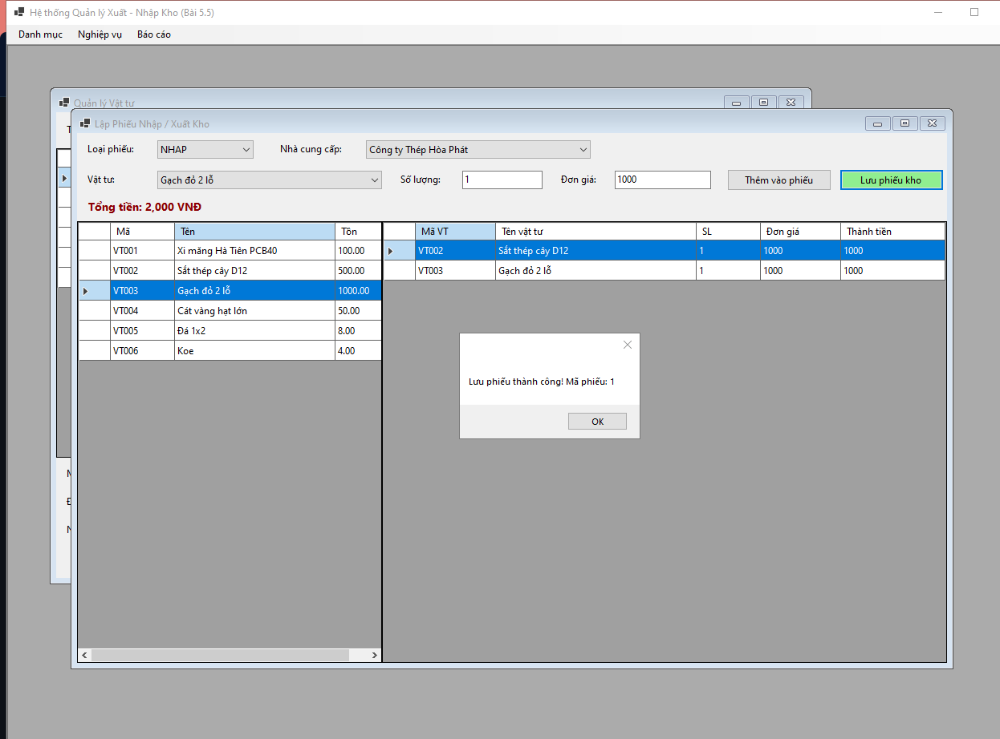

*Mô tả: Form lập phiếu — chọn NHAP/XUAT, thêm vật tư + số lượng + đơn giá, lưu bằng SqlTransaction.*

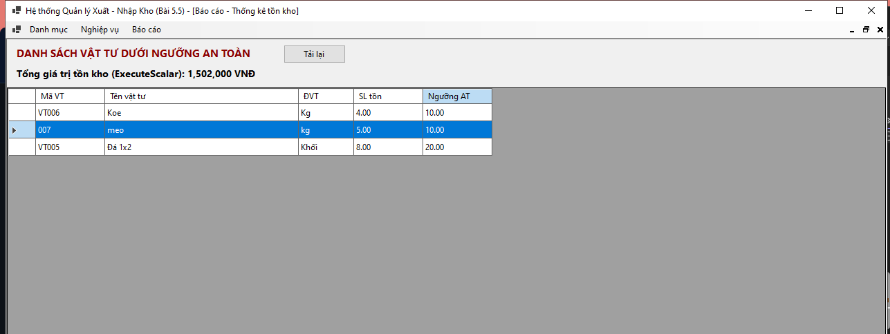

*Mô tả: Lọc vật tư dưới ngưỡng an toàn, tổng giá trị hàng tồn kho (ExecuteScalar).*

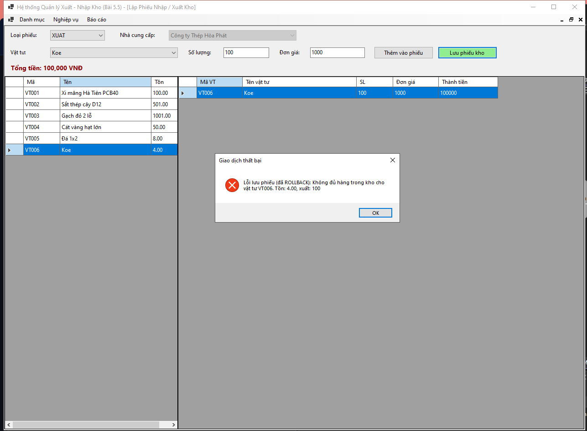

*Mô tả: Xuất kho vượt tồn → `trans.Rollback()` → MessageBox "Không đủ hàng trong kho".*

---

## IV. HƯỚNG DẪN CÀI ĐẶT & CHẠY DỰ ÁN

### 1. Cấu trúc thư mục
D:.
│   .gitignore
│   README.md
│
├───docs
└───src
    ├───B5.3_CafePOS
    │   │   CafePOS.slnx
    │   └───CafePOS
    │       ├───BUS
    │       │       BanAnBUS.cs
    │       │       ChiTietHoaDonBUS.cs
    │       │       DanhMucBUS.cs
    │       │       HoaDonBUS.cs
    │       │       MonAnBUS.cs
    │       │
    │       ├───DAL
    │       │       BanAnDAL.cs
    │       │       ChiTietHoaDonDAL.cs
    │       │       DanhMucDAL.cs
    │       │       DatabaseHelper.cs
    │       │       HoaDonDAL.cs
    │       │       MonAnDAL.cs
    │       │
    │       ├───Database
    │       │       ScriptDB.sql
    │       │
    │       ├───DTO
    │       │       BanAnDTO.cs
    │       │       ChiTietHoaDonDTO.cs
    │       │       DanhMucDTO.cs
    │       │       HoaDonDTO.cs
    │       │       MonAnDTO.cs
    │       │
    │       ├───GUI
    │       │       frmBaoCao.cs
    │       │       frmDoiBan.cs
    │       │       frmQuanLyMenu.cs
    │       │       MainForm.cs
    │       │       MainForm.resx
    ├───B5.4_HotelManagement
    │   │   HotelManagement.slnx
    │   ├───Database
    │   │       ScriptDB.sql
    │   └───HotelManagement
    │       │   HotelManagement.csproj
    │       │   HotelManagement.csproj.user
    │       │   Program.cs
    │       ├───BUS
    │       │       DichVuBUS.cs
    │       │       KhachHangBUS.cs
    │       │       PhieuDatPhongBUS.cs
    │       │       PhongBUS.cs
    │       │       SuDungDichVuBUS.cs
    │       ├───DAL
    │       │       DatabaseHelper.cs
    │       │       DichVuDAL.cs
    │       │       KhachHangDAL.cs
    │       │       PhieuDatPhongDAL.cs
    │       │       PhongDAL.cs
    │       │       SuDungDichVuDAL.cs
    │       ├───DTO
    │       │       DichVuDTO.cs
    │       │       KhachHangDTO.cs
    │       │       PhieuDatPhongDTO.cs
    │       │       PhongDTO.cs
    │       │       SuDungDichVuDTO.cs
    │       ├───GUI
    │       │       FormCheckIn.cs
    │       │       FormCheckOut.cs
    │       │       FormGoiDichVu.cs
    │       │       FormQuanLyDichVu.cs
    │       │       FormQuanLyKhachHang.cs
    │       │       FormQuanLyPhong.cs
    │       │       FormTimKiemPhong.cs
    │       │       MainForm.cs
    └───B5.5_InventoryManagement
        │   InventoryManagement.slnx
        ├───Database
        │       ScriptDB.sql
        └───InventoryManagement
            │   App.config
            │   InventoryManagement.csproj
            │   InventoryManagement.csproj.user
            │   Program.cs
            ├───BUS
            │       NhaCungCapBUS.cs
            │       PhieuKhoBUS.cs
            │       VatTuBUS.cs
            ├───DAL
            │       DatabaseHelper.cs
            │       NhaCungCapDAL.cs
            │       PhieuKhoDAL.cs
            │       VatTuDAL.cs
            ├───DTO
            │       ChiTietPhieuKhoDTO.cs
            │       NhaCungCapDTO.cs
            │       PhieuKhoDTO.cs
            │       VatTuDTO.cs
            ├───GUI
            │       frmBaoCao.cs
            │       frmNhaCungCap.cs
            │       frmPhieuKho.cs
            │       frmVatTu.cs
            │       MainForm.cs